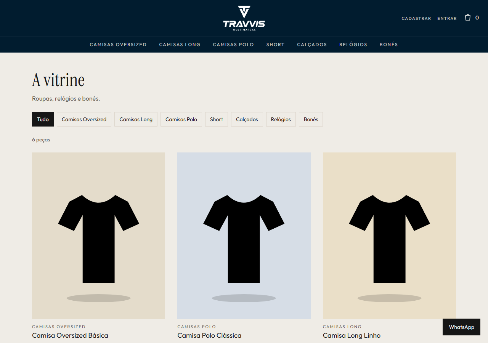
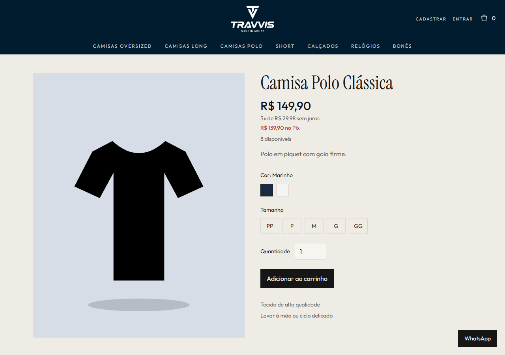
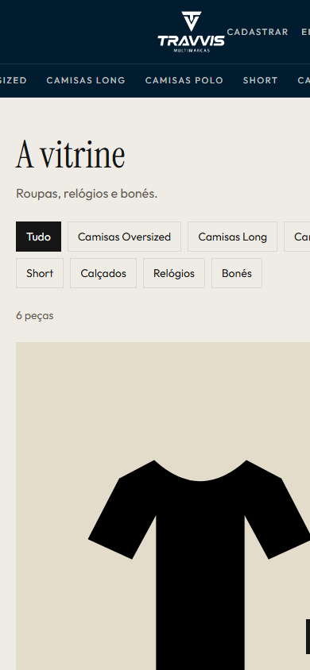

# Travvis Multimarcas

[](https://github.com/Daavi007/Travvis/actions/workflows/ci.yml)

Loja virtual de moda masculina (camisas, shorts, bermudas, calçados, relógios e bonés) com catálogo, carrinho, checkout com **PIX** e **Mercado Pago**, e painel administrativo para o lojista cadastrar produtos sem mexer no código.

## Prévia

<p align="center">
  
  
</p>
<p align="center">
  
</p>

> Prints com um catálogo fictício de demonstração.

## Funcionalidades

- **Catálogo** por categoria, com página de produto (tamanhos, cores, estoque e galeria de imagens)
- **Carrinho** com persistência no navegador
- **Checkout** com três formas de fechar o pedido:
  - **PIX** com QR Code e código "copia e cola" gerados no próprio site
  - **Cartão** via Mercado Pago
  - **WhatsApp**, enviando o pedido pronto para o lojista
- **Painel administrativo** protegido por login: cadastro, edição e remoção de produtos, com tamanhos indisponíveis marcados
- **API de produtos** em Cloudflare Workers, com o catálogo guardado em Cloudflare KV

## Tecnologias

| Camada | Tecnologias |
| --- | --- |
| Front-end | Next.js 14 (export estático), React 18, TypeScript, Tailwind CSS |
| Back-end | Cloudflare Workers, Cloudflare KV |
| Pagamentos | Mercado Pago, PIX (QR Code com `qrcode`) |
| Deploy | Wrangler (Cloudflare) |

## Como rodar localmente

Pré-requisito: Node.js 18 ou superior.

```bash
npm install
cp .env.example .env.local   # preencha as variáveis (veja abaixo)
npm run api                  # API de produtos local em http://127.0.0.1:8788
npm run dev                  # site em http://localhost:3000
```

### Variáveis de ambiente

| Variável | Para que serve |
| --- | --- |
| `MERCADO_PAGO_ACCESS_TOKEN` | Pagamento com cartão. Sem ela, o cartão segue pelo WhatsApp |
| `NEXT_PUBLIC_SITE_URL` | Endereço público do site |
| `ADMIN_USER` / `ADMIN_PASSWORD` | Login do painel administrativo (`/admin`) |

Os dados da loja (nome, WhatsApp e chave PIX) ficam em `lib/config.ts`.

## Testes

```bash
npm test
```

São 21 testes automatizados (Vitest) que cobrem as regras mais sensíveis da loja:

- **PIX:** o código gerado termina com o CRC16 correto, formata valor e nomes conforme o padrão do Banco Central
- **Carrinho:** o preço vem sempre do catálogo (nunca do cliente), e itens inválidos, tamanhos inexistentes ou quantidade acima do estoque são descartados
- **API do painel admin:** alterações exigem login, e criar, editar e remover produtos funcionam só com as credenciais corretas
- **Preços e mensagem do pedido:** parcelas, desconto no PIX e texto enviado ao WhatsApp

Os mesmos testes, a checagem de tipos e o build rodam a cada envio pelo GitHub Actions.

## Deploy

```bash
npm run build    # gera o site estático em ./out
npm run deploy   # publica na Cloudflare com o Wrangler
```

## Estrutura

```
app/          páginas (home, produtos, produto, carrinho, checkout, admin)
components/   interface (cards, carrinho, checkout, login do admin)
lib/          catálogo, formatação, geração do PIX, pedido e WhatsApp
worker/       Cloudflare Worker (API de produtos + arquivos estáticos)
server/       rotas de pagamento (PIX e Mercado Pago)
scripts/      API de produtos para desenvolvimento local
```

## Autor

Desenvolvido por **David Silva Brito**
